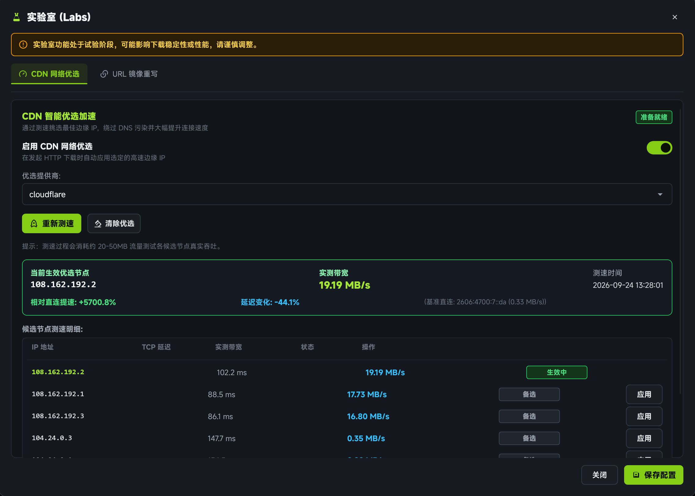

# CDN Acceleration

When downloading from cross-border open-source hubs (such as **GitHub Releases**, **HuggingFace model checkpoints**, or Linux distribution mirrors), conventional download clients often suffer severe speed bottlenecks.

The culprit is almost always DNS misrouting: Local ISP resolvers and Anycast routing policies frequently steer requests to congested, packet-dropping, or throttled CDN edge nodes.

limedl features a proprietary **CDN Probe Acceleration System** that combines concurrent latency screening, real-world throughput benchmarks, and transport-layer DNS rewriting within the Rust HTTP networking stack to achieve full-speed downloads without requiring third-party proxies.

---

## How It Works Under the Hood

```
┌─────────────────────────────────────────────────────────────┐
│ 1. Host Recognition                                         │
│    Detects if the URL belongs to the selected CDN provider  │
└──────────────────────────────┬──────────────────────────────┘
                               │
                               ▼
┌─────────────────────────────────────────────────────────────┐
│ 2. Concurrent Latency Screening (Screening Phase)           │
│    Fires rapid TCP/TLS handshakes across provider CIDRs     │
│    Filters out high-latency and unstable edge nodes         │
└──────────────────────────────┬──────────────────────────────┘
                               │
                               ▼
┌─────────────────────────────────────────────────────────────┐
│ 3. Throughput Benchmarking (Measuring Throughput)           │
│    Runs short sustained chunk transfers on top candidates   │
│    Determines actual downstream throughput (MB/s)           │
└──────────────────────────────┬──────────────────────────────┘
                               │
                               ▼
┌─────────────────────────────────────────────────────────────┐
│ 4. Transport-Layer DNS Rewriting (Resolver Injection)       │
│    Directs reqwest to bind the domain to the chosen IP      │
│    [Preserves valid TLS SNI and Host headers completely]    │
└─────────────────────────────────────────────────────────────┘
```

### Why Preserving TLS SNI and Host Headers Matters
Traditional hacks involving hostfile modifications or transparent reverse proxies frequently trigger invalid TLS certificate errors (`ERR_CERT_COMMON_NAME_INVALID`).

limedl interfaces directly with Rust's `reqwest::ClientBuilder::resolve` mechanism:
- **Socket Connection**: Establishes raw TCP sockets directly to the selected high-speed edge IP.
- **TLS Handshake**: Transmits the original hostname in the TLS SNI (Server Name Indication) extension.
- **HTTP Layer**: Supplies the original `Host` header.

As a result, connections remain 100% compliant with standard TLS verification, guaranteeing cryptographic privacy and avoiding certificate warnings.

---

## Using the CDN Probe in the Desktop Client

### Step 1: Open the Labs Panel
Open the **Settings** dialog from the left sidebar and switch to the **Labs** tab, then select the **CDN Network Optimization** section.



### Step 2: Run the Benchmark
Click the **"Start Test"** button:
- The `CdnAccelerator` state machine in the background loads the selected provider's IP blocks and executes concurrent connection tests.
- Real-time progress is broadcast over the internal `EventBus` directly to the UI.
- Once finished, candidates are ranked by score, detailing **IP Address**, **TCP Latency**, and **Measured Throughput (MB/s)**.

### Step 3: Apply the Optimized Node
Select the highest-performing IP (marked with a green recommended badge) and click **"Apply IP"**:
- The configuration is applied instantly and saved to `settings.json`.
- Subsequent downloads matching supported CDN domains will route through this edge node automatically.

---

## Choosing and Customizing a CDN Provider

The Labs CDN panel supports three providers:

- **Cloudflare** (default): built-in Anycast ranges and test URL;
- **Fastly**: Fastly's static ranges and test URL;
- **Custom**: supply your own test URL plus IPv4 / IPv6 CIDR lists (one per line), for self-hosted Anycast or third-party CDNs.

Re-run the speed test after switching providers; an applied node from the previous provider is not migrated automatically. A test consumes roughly 20–50 MB of traffic. After applying a node, only domains that fall inside the selected provider's ranges use acceleration; other domains keep normal DNS.

## URL Rewrite Rules for Mirror Acceleration

Under **Labs -> URL Rewrite Rules**, limedl supports regex pattern rewriting to redirect slow upstream resources to accelerated mirror endpoints.

### Real-World Example: Accelerating GitHub Releases
Many users experience sluggish speeds or dropped connections when downloading large binaries from GitHub Releases.

Add a regex rewrite rule:
- **Match Pattern (Regex)**:
  ```regex
  ^https://github\.com/([^/]+)/([^/]+)/releases/download/(.+)$
  ```
- **Target Replacement**:
  ```text
  https://mirror.ghproxy.com/https://github.com/$1/$2/releases/download/$3
  ```

Once active, submitting standard GitHub release links via the clipboard or browser extension will automatically rewrite the URL to the designated mirror before dispatch, preserving file metadata and checksum validation intact.
